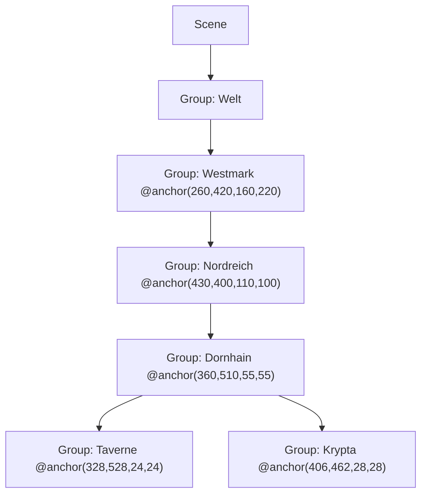

# ADR-SWS-01 — Shared World Space & Continuous Hierarchical LOD

- **Status:** Proposed (Draft — wartet auf Freigabe; **kein** produktiver Code, **keine** GitHub-Issues vor Freigabe)
- **Datum:** 2026-11-25
- **Bezug:** `sws-architecture-snapshot.md`, `sws-root-cause.md`
- **Bezug ADRs:** ST-10 (Custom WebGL SoT), ST-11 (Three.js conditional GO) — **nicht ersetzt**, sondern renderer-unabhängig ergänzt.
- **Kennzeichnung:** ✅ verifiziert · 🧩 Schlussfolgerung · ❓ Annahme · 🔴 offene Entscheidung

---

## 1. Kontext

Der Unified Atlas besteht heute aus **semantisch verlinkten, räumlich und geometrisch unabhängigen** Maps
(`world_atlas_maps` + `parent_map_id` + `ParentSpatialAnchor`), gerendert als **Single-Active-Doc** mit
Doc-Swap + Opacity-Fade (RC-1..RC-5, siehe Root-Cause). Ben-Anforderung: eine **kontinuierlich navigierbare Welt**
(Google-Maps-Gefühl) mit editierbaren Fantasy-Landschaften, Gebäuden, Innenräumen, Dungeons.

**Entscheidung des Owners (2026-11-25):** Variante **B+ — Incremental Shared World Space Migration**.
Kein Big-Bang-Rewrite, keine oberflächliche Reparatur durch Kameraanimationen/Screenshots/Fade-Overlays.

**Renderer-Vorgabe (Owner, 2026-11-25):**
- Shared World Space wird **renderer-unabhängig im Domain-Layer** geplant.
- **Three.js** bleibt der präferierte produktive Renderer, **sofern** die bestehenden Architektur-/Performance-Gates (ST-11, R02–R05) erfüllt werden.
- Der **Gemini-Branch** wird anhand der bestehenden ADRs/ST-11-Gates **evaluiert**, aber **nicht ungeprüft** als Grundlage der Zielarchitektur übernommen.
- **Custom WebGL** nur dort, wo konkrete technische Anforderungen oder reproduzierbare Messungen seine Notwendigkeit belegen.
- **Keine** parallelen vollständigen Rendering-Engines, **keine** spekulativen Renderer-Abstraktionen.

---

## 2. Entscheidung

Wir führen einen **Unified World Space** ein: einen einzigen, rekursiv komponierten räumlichen Bezugsrahmen, in den
**bestehende** lokale Koordinatensysteme (`UnifiedCanvasDoc` 0…1000 pro Map) über ihre `ParentSpatialAnchor`
mathematisch konsistent eingebettet werden.

**Kernentscheidungen:**

1. **Lokale Koordinatensysteme bleiben erhalten.** Keine Migration zu globalen Absolut-Koordinaten in der Persistenz.
   Die Weltkoordinate ist eine **abgeleitete, berechnete** Größe (Komposition der Anchor-Kette), kein gespeicherter Wert.
2. **Renderer-unabhängige Domain.** Rekursive Transformation, Geometry Ownership, LOD-Bänder und Anchor-Validierung
   leben in `src/domains/world/atlas/` (kein Three.js, kein React, kein Host).
3. **Multi-Map-Scene-Graph ersetzt Single-Active-Doc.** Der Renderer hält einen räumlichen Graphen relevanter
   Maps (Parent + Kinder + Nachbarn), platziert via Anchor — statt ein Doc zu swappen.
4. **Continuous Hierarchical LOD** mit additivem + Replacement-Refinement, kamera- (nicht breadcrumb-) getrieben,
   mit Hysterese, Prefetch, Culling, Budgets.
5. **Geometry Ownership mit Single Source of Truth** pro geometrischer Struktur. Keine bidirektionale Sync
   gleichberechtigter Quellen.
6. **Unified Camera + Unified Input** als gemeinsamer, map-unabhängiger Zustand (inkl. MacBook-Trackpad).

---

## 3. Coordinate-Space-Modell

### 3.1 Begriffe

- **Local Space:** der bestehende 0…1000-Raum eines `UnifiedCanvasDoc`. ✅ bleibt.
- **Parent Space:** der Local Space der Eltern-Map.
- **World Space:** der Local Space der **Wurzel-Map** (Welt). Definiert als der einzige Raum ohne Parent.
- **Transform `T(map)`:** die Komposition aller Anchors von `map` bis zur Wurzel.

### 3.2 Rekursive Transformation (neu, Domain)

```text
localToWorld(map, p):
  if map.parentAnchor == null:            # Wurzel erreicht
    return p
  p_parent = childLocalToParentPoint(map.parentAnchor, p, map.bounds)   # ✅ existiert
  return localToWorld(parentMap, p_parent)                              # 🔁 Rekursion (neu)

worldToLocal(map, p_world):  # inverse Kette, nutzt parentPointToChildLocal ✅
```

- Iterativ mit **Zyklus-Guard** (`visited:Set`), fail-closed bei Zyklus / unverortetem Anchor.
- **Höhe (Z):** Anchor ist 2D. 🔴 **D2:** Welt-Z wird über ein neues optionales `elevationBase`/`metersPerUnitZ` am Anchor
  oder ein separates Höhen-Anchor-Feld modelliert — **offene Entscheidung**, siehe §3.4.

### 3.3 Skalierung / Rotation / Scherung ⚠️

Bestehende Anchors erlauben `extentX ≠ extentY` (nicht-uniform) → Scherung bei Rotation (§1.8).

**Entscheidung (Vorschlag):**
- Einführung eines **Affine-Transform-Modells** (2×3-Matrix) pro Anchor als **berechnete** Normalform, aus
  `center/extent/rotation` abgeleitet. Bestehende Felder bleiben die **Authoring-Form**.
- **Golden/Bestand:** `rotationRad=0` → keine Scherung; Seitenverhältnis-Verzerrung ist **gewollt** (ein Rechteck-Ausschnitt
  einer nicht-quadratischen Region). ✅ unkritisch solange rotation=0.
- **Regel neu:** bei `rotationRad ≠ 0` **muss** `extentX == extentY` (uniform) gelten, sonst Validierungsfehler —
  verhindert unkontrollierte Scherung. 🔴 **D6:** Bestätigung, dass rotierte, nicht-uniforme Bestands-Anchors nicht existieren
  (Golden: keine; produktive Nutzerdaten: zu prüfen).

### 3.4 Numerische Stabilität / Floating Origin ❓

- Local 0…1000 pro Map → Welt-Koordinaten bleiben durch **Multiplikation von Extents** bei sinnvollen Tiefen klein
  (z. B. 6 Ebenen × Faktor ~10–100). 🧩 Für die Golden-Welt (max. 5 Ebenen) **kein** Float-Präzisionsproblem zu erwarten.
- **Floating Origin / kamerarelative Koordinaten** werden **nicht präventiv** eingeführt (YAGNI), sondern erst bei
  nachgewiesener Präzisionsproblematik (gemessene Z-Fighting-/Jitter-Artefakte bei großen Welten). ❓ Annahme: Welten
  bleiben vorerst < ~10^6 Welt-Einheiten. **Messkriterium** statt Vermutung: Vertex-Jitter-Test am Vertical Slice.

### 3.5 Zyklus-Erkennung (Schreib-Guard, neu) 🔴

Bestehend: nur Lese-Guard (`buildMapBreadcrumb`). **Neu:** `upsertMap` lehnt `parent_map_id` ab, wenn die Zielkette
die eigene ID enthält (rekursiver Walk im Service vor Persistenz). Behebt Snapshot §1.7.

---

## 4. Geometry-Ownership-Modell (Single Source of Truth)

### 4.1 Prinzip

Pro **physischer Struktur** genau **eine** autoritative Quelle. Keine bidirektionale Synchronisation.

### 4.2 Ownership-Zuordnung (Vorschlag, Golden)

| Struktur | Autoritative Ebene | Grobe Darstellung auf anderen Ebenen |
|---|---|---|
| Landmasse / Küste | **Kontinent** (feinste Küsten-Polygone) | Welt = vereinfachte Projektion (derived) |
| Politische Grenze | **Land** (Nordreich) | Kontinent/Welt = Vektor-Overlay (derived) |
| Terrain / Höhe | **Ort** Heightfield (Dornhain-Hügel) | Land/Kontinent = niedrig-aufgelöste Ableitung |
| Flüsse / Straßen | **Land/Ort** (wo sie phys. verlaufen) | übergeordnet = Stroke-Segment (derived) |
| Wälder | **Ort** (Stamp-Cluster) | übergeordnet = Forest-Region (derived) |
| Gebäude-Footprint | **Ort** (Tavernen-Stamp) | — |
| Fassade / Dach / Stockwerk | **Gebäude** | Ort = Footprint only |
| Raum-Wände / Möbel | **Raum** (room_geometry, ✅ schon deklariert) | Gebäude = Cutaway-Hülle |
| Dungeon | **Szene/Krypta** (forge-committed) | Ort = Eingangs-Stamp |

### 4.3 Ableitungsrichtung (🔴 D1 — zentrale offene Entscheidung)

Zwei zulässige, **nicht mischbare** Strategien pro Struktur:

- **Bottom-Up (derive-coarse-from-fine):** feinste Ebene ist autoritativ; grobe Ebenen werden **abgeleitet**
  (Generalisierung: Küsten-Simplification, Heightfield-Downsampling, Stamp→Region-Aggregation). ✅ konsistent mit
  „Ort ist Teil des Landes".
- **Top-Down (refine-coarse-into-fine):** grobe Ebene ist autoritativ; feinere Ebenen **verfeinern** lokal
  (Detail-Infill innerhalb des Anchor-Rects).

🧩 **Empfehlung:** **Bottom-Up** als Default für physische Geographie (Küste, Fluss, Terrain), weil sie die von Ben
gewünschte Konsistenz („derselbe Fluss auf jeder Ebene") garantiert; **Top-Down** nur für **prozedurale Infill**
(Dungeon-Layouts, Scatter), wo keine grobe Wahrheit existiert.

⚠️ **R1 (Bestandskonflikt):** Golden ist heute widersprüchlich (Kontinent-Polygon vs. Nordreich-Rechteck). Migration muss
**pro Struktur** eine Gewinner-Quelle bestimmen (manuell, Owner-Entscheid) und die andere Ebene daraus ableiten.

### 4.4 Genügt das bestehende CanvasDoc? 🔴

❓ **Annahme (zu validieren):** `UnifiedCanvasDoc` + klarer `AtlasFeatureOwner` + Ableitungs-Cache **genügt** — **keine**
neue globale Objekt-DB. Begründung: räumliche Objekte haben heute keine eigenständige Identität außerhalb ihrer Map;
eine Ownership-Markierung + derived-Cache erspart eine neue Persistenz.

🔴 **Offen:** Ob Ableitungen **persistiert** (materialisiert, mit Fingerprint-Invalidierung) oder **zur Laufzeit berechnet**
werden. Vorschlag: materialisiert + `contentFingerprint` (existiert bereits in `atlas-hierarchy-lod` Cache) zur Invalidierung.

---

## 5. Spatial Scene Graph (Renderer-seitig, Domain-gesteuert)

### 5.1 Zielbild



- Jede Map = eine **Group** mit **Transform = Anchor** (Translation + Rotation + nicht-uniforme Skalierung).
- Sichtbarkeit/Detailtiefe pro Group über **Continuous LOD** (§6), nicht über Doc-Swap.
- **Kein** `clearRoot()` bei Zoom/Navigation — nur geänderte Subtrees werden inkrementell aktualisiert.
- **Disposal-Ownership:** jede Group besitzt ihre GPU-Ressourcen; `AtlasGpuResourceSession` (✅ existiert) trackt sie.

### 5.2 Vermeidung doppelter Geometrie / Z-Fighting

- **Replacement-Refinement:** grobe Parent-Geometrie wird im Anchor-Rect **ausgestanzt/deaktiviert**, wenn die
  detaillierte Kind-Geometrie aktiv ist (kein Übereinander zweier Küsten).
- **Additive Refinement:** Kind fügt nur **neue** Details hinzu (Möbel, Props) — keine Überlappung mit Parent-Flächen.

### 5.3 Renderer-Unabhängigkeit

Der Scene-Graph-**Plan** (welche Maps, welche Transforms, welche LOD-Stufe) ist eine **Domain-Datenstruktur**
(`AtlasWorldScenePlan`). Der konkrete Renderer (Three.js / ggf. Custom WebGL) **konsumiert** den Plan.
🧩 Das erfüllt die Owner-Vorgabe „fachliche Weltarchitektur unabhängig von Rendering-Technologie" ohne spekulative
Abstraktion: der Plan ist eine konkrete, getestete Datenstruktur, kein generisches Renderer-Interface.

---

## 6. Continuous Hierarchical LOD

### 6.1 Treiber: Kamera, nicht Breadcrumb

LOD-Entscheidung aus **Screen-Space-Error (SSE)** bzw. Näherung über `view.span` relativ zum Anchor-Extent:

```text
sse(child) ≈ (childFeatureSize_world / view.span) * viewportPx
refine wenn sse > thresholdHi ; vergröbern wenn sse < thresholdLo   # Hysterese (Hi > Lo)
```

- ❌ Abschaffung von `lodBandFromBreadcrumbDepth` als Render-Treiber (bleibt ggf. für semantische Labels).
- Überlappende Detailbereiche: Parent grob + Kind fein **gleichzeitig** sichtbar während Übergang.

### 6.2 Refinement-Arten

- **Additiv:** Props/Möbel/Vegetation erscheinen mit zunehmendem Zoom (Opacity-/Scale-Fade-in der **Geometrie**, nicht des ganzen Docs).
- **Replacement:** grobe Küste wird durch feine ersetzt (§5.2).

### 6.3 Streaming / Budgets

- **Prefetch:** ✅ `decidePrefetchChildMap` + `mapCache` wiederverwenden; erweitert um räumliche Nachbarschaft (nicht nur direkte Kinder).
- **Culling:** Frustum-Culling pro Group (Three.js `frustumCulled`); Domain liefert AABBs (`parentAnchorAabb` ✅).
- **Budgets:** bestehende `ATLAS_PERF_BUDGET_THRESHOLDS` erweitern um **Multi-Map**: max gleichzeitig geladene Maps,
  max Gesamt-Instanzen über alle Groups, Frame-P95 auf Zielhardware. 🔴 Zielhardware-Profile §Vertical-Slice-Spec.

---

## 7. Unified Camera & Unified Input

### 7.1 Kamera

- **Ein** `AtlasWorldCameraState` (Domain): `{ focusWorld: {x,y,z}, span, yawRad, pitchRad, projection }`.
- 2D = ortho-topdown-Projektion **derselben** Welt; 3D = diorama/perspective. **Kein** getrennter 2D-Kamerazustand.
- Mode-Wechsel **erhält** focus/yaw/span (behebt `switchCameraMode`-Yaw-Reset).
- 🔴 **D7:** Ob der separate Canvas-2D-Renderer durch Three.js-Ortho ersetzt wird, wird **erst nach nachgewiesener
  Funktionsparität** entschieden (Owner-Vorgabe: keine vorschnelle Entfernung). Bis dahin: 2D-Canvas liest **denselben**
  `AtlasWorldCameraState`.

### 7.2 Input (MacBook-Verifizierung erforderlich)

| Geste | Behandlung |
|---|---|
| Zwei-Finger-Scroll | Pan (`wheel` deltaX/deltaY) |
| Trackpad-Pinch | `wheel` mit `ctrlKey=true` (Chromium) + `gesturestart/change` (Safari) → Zoom zum Cursor |
| Shift+Drag / Rechts-Drag | Orbit/Pitch |
| Doppelklick | Fokus + Zoom auf Objekt |

- **Delta-Normalisierung** (`deltaMode` 0/1/2), passive Listener + `preventDefault` gegen Browser-Zoom.
- ❓ **Annahme:** Playwright kann Trackpad-Pinch **nicht** zuverlässig emulieren → **Hardware-Verifizierung** auf echtem
  MacBook ist verbindlicher Acceptance-Bestandteil (Owner-Vorgabe §6).

---

## 8. Gebäude / Innenräume / Portale

- **Räumlich anschließende** Innenräume (Taverne in Dornhain) werden **in denselben World Space** eingebettet (§5).
- **Nicht räumlich anschließende** Szenen (z. B. „Taschendimension", weit entfernte Dungeon-Instanz) erhalten explizite
  **Portal-Grenzen**: eine markierte Transform-Diskontinuität, bei der ein definierter Übergang erlaubt ist.
  🧩 Die Golden-Krypta ist räumlich **unter** Dornhain verortet (Anchor 406,462) → **kein** Portal, sondern
  Cutaway/Untergrund-LOD.
- Roof-Hiding/Cutaway: ✅ `autoCutaway` existiert (`ensureScene`); wird auf Group-Ebene verfeinert.

---

## 9. Alternativen (abgelehnt)

| Alternative | Grund der Ablehnung |
|---|---|
| **A — Nested-LOD nur als Render-Kaschierung** | Löst RC-3 nicht (widersprüchliche Geometrie bleibt). Von Owner explizit ausgeschlossen. |
| **Big-Bang Shared-Space-Rewrite** | Migration-Risiko, bricht Bestandsdaten, verletzt B+-Vorgabe. |
| **Tile-Server / Cesium / Unreal / 3D-Tiles** | YAGNI — Anchor-Bausteine existieren; externe Infra erst nach Unzulänglichkeits-Nachweis. |
| **Neue globale Objekt-Datenbank** | §4.4 — CanvasDoc + Ownership genügt voraussichtlich. |
| **Globale Absolut-Koordinaten in Persistenz** | Verwirft funktionierende lokale Systeme; Weltkoordinate ist ableitbar. |
| **Spekulative Renderer-Abstraktion** | Owner-Verbot; Domain-Plan ist konkrete Datenstruktur, kein Interface-Zoo. |

---

## 10. Konsequenzen

**Positiv:**
- Eine konsistente Welt, kontinuierlicher Zoom, keine Kaschier-Overlays.
- Nutzt vorhandene Bausteine (Anchor, Transformation, LOD-State, Cache, Perf-Budgets).
- Renderer-unabhängig → nicht an ST-11-Gate-Status gekoppelt.

**Kosten / Risiken:**
- ⚠️ RC-3-Migration erfordert **manuelle** Bestandskonflikt-Auflösung (Golden).
- ⚠️ Größter Eingriff: Scene Graph (RC-1) — betrifft Selektion, Raycasting, Drag&Drop, Undo/Redo (müssen auf Multi-Map umgestellt werden).
- 🔴 Undo/Redo-Parität im 3D-Pfad muss vor Vertical-Slice-Abnahme hergestellt werden (derzeit nur 2D).

**Legacy-Exit:**
- Single-Active-Doc-Pfad + `AtlasPortalTransitionOverlay`-Kaschierung werden **erst** entfernt, wenn der Multi-Map-Pfad
  Funktionsparität + Datenintegrität + Performance nachweist (Owner-Vorgabe §5: keine dauerhaften Parallelarchitekturen,
  eindeutige Exit-Kriterien).
