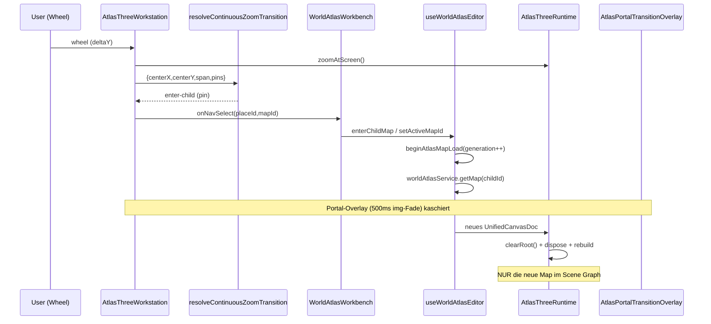
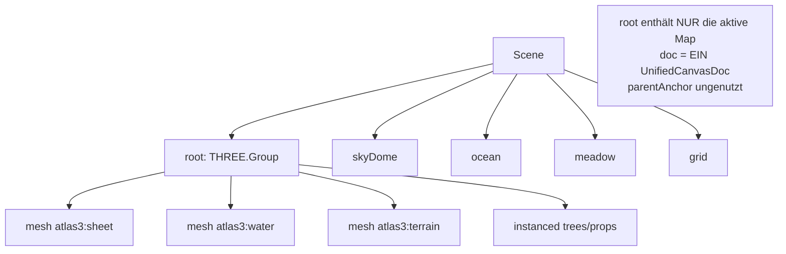
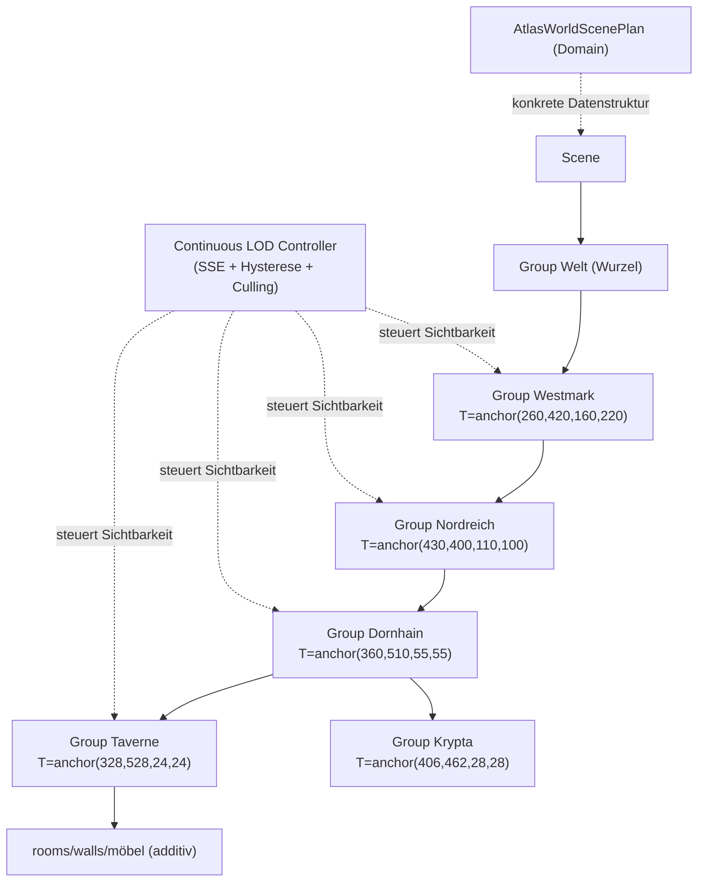
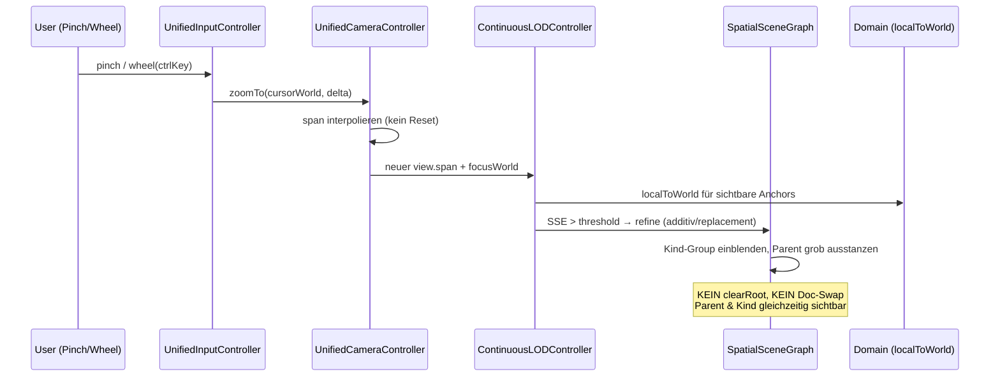
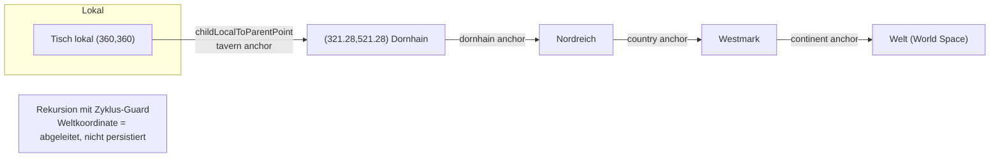
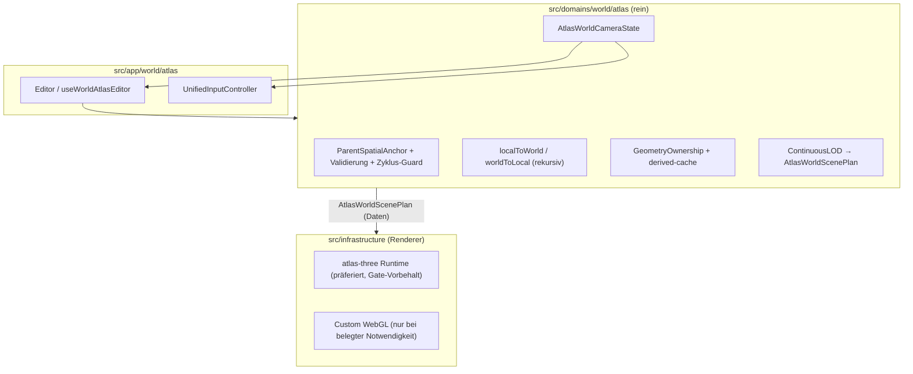

# SWS — Architekturdiagramme (Current / Target)

- **Status:** Planungsartefakt zu `sws-adr-shared-world-space.md`. Mermaid.
- **Kennzeichnung:** ✅ verifiziert (aus Code abgeleitet) · 🧩 Zielbild

---

## 1. Current-State (verifiziert)

### 1.1 Daten- und Navigationsfluss beim Reinzoomen (Ist)

🧩 Der Fade (OV) läuft **parallel** zum Doc-Swap — er interpoliert **nicht** die Geometrie, sondern verdeckt den Cut.

### 1.2 Current Scene Graph (Single-Active-Doc)

---

## 2. Target-State (Zielbild)

### 2.1 Target Scene Graph (Multi-Map, Anchor-verschachtelt)

### 2.2 Target Datenfluss beim Reinzoomen (Soll)

### 2.3 Coordinate-Space-Komposition

### 2.4 Schichtentrennung (Renderer-Unabhängigkeit)

🧩 **Wichtig:** `AtlasWorldScenePlan` ist eine **konkrete Datenstruktur**, kein generisches Renderer-Interface — erfüllt
Renderer-Unabhängigkeit ohne spekulative Abstraktion (Owner-Vorgabe).

---

## 3. Renderer-Evaluationsrahmen (Gemini-Branch, offen)

🔴 Der Gemini-Branch (`feat/atlas-phase0-forge-tools-and-adr11`) mountet `AtlasThreeWorkstation` produktiv innerhalb
`AtlasNative3dEditor`. Bewertung gegen ST-11-Gates:

| Kriterium | Befund |
|---|---|
| Nutzt Three.js | ✅ ja |
| Single-Active-Doc | ⚠️ ja — **kein** Multi-Map-Scene-Graph (RC-1 unverändert) |
| Geometry Ownership | ❌ nein — Golden weiterhin unabhängig gezeichnet |
| Undo/Redo im 3D-Pfad | ❌ nein (`AtlasThreeWorkstation` ohne `atlas-edit-history`) |
| Trackpad Pinch/Orbit | ❌ nein |
| ST-11 R02–R05 Gate-Zuordnung | 🔴 nicht dokumentiert — produktiv vor R04 (#1269) |

🧩 **Schlussfolgerung:** Der Gemini-Branch liefert wertvolle Three.js-**Rendering**-Bausteine (PBR, Scene/Camera-Runtime,
Perf-Integration), löst aber **keine** der Root Causes RC-1/2/3. Er ist **Material-Lieferant** für den Three.js-Renderer,
**nicht** Grundlage der Shared-World-Space-Architektur. Übernahme nur nach ST-11-Gate-Zuordnung und RC-Auflösung.
