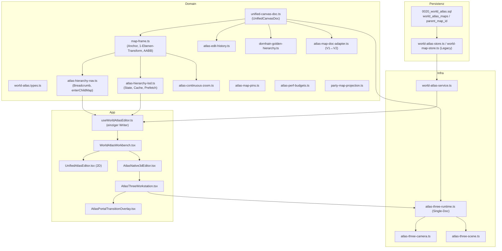
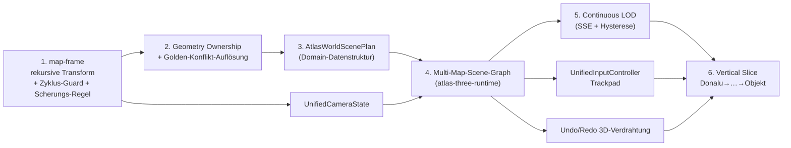

# SWS — Dependency Map

- **Status:** Planungsartefakt. ✅ verifiziert · 🧩 Schlussfolgerung
- **Zweck:** Zeigt, welche bestehenden Module von der Shared-World-Space-Migration betroffen sind und in welcher Reihenfolge sie angegangen werden müssen.

---

## 1. Modul-Abhängigkeiten (Ist, aus Imports abgeleitet)

---

## 2. Betroffenheits-Matrix (welche Root Cause trifft welches Modul)

| Modul | RC-1 Scene | RC-2 Transform | RC-3 Geometry | RC-4 LOD | RC-5 Cam/Input | Änderungsaufwand |
|---|:-:|:-:|:-:|:-:|:-:|---|
| `map-frame.ts` | — | **hoch** (Rekursion, Scherung, Zyklus-Guard) | mittel (Ownership-Hints durchsetzen) | — | — | mittel |
| `unified-canvas-doc.ts` | — | — | **hoch** (Ownership-Marker) | — | — | mittel |
| `atlas-hierarchy-nav.ts` | hoch (kein Doc-Swap mehr) | mittel | — | hoch (Breadcrumb entkoppeln) | — | hoch |
| `atlas-hierarchy-lod.ts` | hoch | mittel | — | **hoch** (SSE statt Breadcrumb) | — | hoch |
| `atlas-continuous-zoom.ts` | mittel | mittel | — | **hoch** (kontinuierlich statt diskret) | mittel | hoch |
| `atlas-edit-history.ts` | mittel (Multi-Map) | — | — | — | **hoch** (3D-Verdrahtung fehlt) | mittel |
| `atlas-three-runtime.ts` | **hoch** (Multi-Map-Graph) | mittel (Anchor anwenden) | mittel | hoch | — | **sehr hoch** |
| `atlas-three-camera.ts` | — | — | — | — | **hoch** (Unified State) | mittel |
| `useWorldAtlasEditor.ts` | hoch (kein Single-Doc) | mittel | mittel | hoch | mittel | hoch |
| `AtlasThreeWorkstation.tsx` | hoch | — | — | mittel | **hoch** (Trackpad, Yaw) | hoch |
| `AtlasPortalTransitionOverlay.tsx` | hoch (entfällt für räumliche Übergänge) | — | — | — | — | niedrig (Deprecation) |
| `UnifiedAtlasEditor.tsx` (2D) | — | — | — | — | **hoch** (gemeinsamer Cam-State) | mittel |
| `dornhain-golden-hierarchy.ts` | — | — | **hoch** (Konflikt-Auflösung) | — | — | mittel (manuell) |
| `world-atlas-store.ts` | — | mittel (Schreib-Zyklus-Guard) | mittel | — | — | niedrig |
| `party-map-projection.ts` | — | mittel (Projektion im World Space) | — | — | — | niedrig |

---

## 3. Kritischer Pfad (Reihenfolge)

🧩 **Bottleneck:** Schritt 1 (rekursive Transformation) und Schritt 2 (Geometry Ownership) sind **Voraussetzung** für alles
Weitere und können **parallel** laufen. Schritt 4 (Multi-Map-Scene-Graph) ist der größte Einzelaufwand und hängt von 1+2+3 ab.

---

## 4. Was unverändert bleibt (Wiederverwendung)

✅ `parentAnchorFromParentRect`, `childLocalToParentPoint`, `parentPointToChildLocal`, `parentAnchorAabb`, `parentAnchorsOverlapAabb`
✅ `atlas-hierarchy-lod` Cache/Prefetch/State-Machine (Basis, wird erweitert nicht ersetzt)
✅ `atlas-perf-budgets` Schwellen + `AtlasGpuResourceSession`
✅ `atlas-edit-history` Snapshot-Logik (nur Verdrahtung im 3D-Pfad neu)
✅ `dungeon-generator` / `dungeon-forge-workflow` (prozeduraler Infill = Top-Down-Ausnahme)
✅ Three.js PBR/Materialien/PostFX aus Gemini-Branch (als Renderer-Bausteine)
✅ SQLite-Schema `world_atlas_maps` (nur erweitert, nicht ersetzt)
