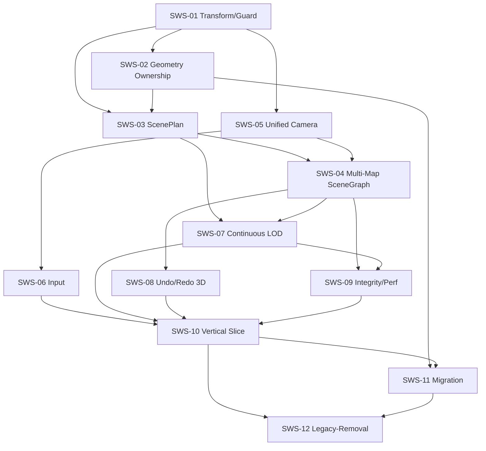

# SWS — Epic- und Issue-Plan (Entwurf, nicht auf GitHub erstellt)

- **Status:** Entwurf zur Freigabe. **Keine** GitHub-Issues, **kein** produktiver Code vor Freigabe.
- **Bezug:** ADR-SWS-01, Root-Cause, Dependency-Map, Breaking-Change-Matrix, Vertical-Slice-Spec.
- **Namensraum (Vorschlag):** Epic **SWS** („Shared World Space"). Issues **SWS-01…SWS-12**. 🔴 finale Nummerierung beim Anlegen.

---

## Epic SWS — Shared World Space & Continuous LOD

**Ziel:** Der Unified Atlas wird eine einzige, kontinuierlich navigierbare, räumlich konsistente Welt
(Welt→Kontinent→Land→Ort→Gebäude→Raum→Objekt) statt einer Sammlung verlinkter Karten. Google-Maps-Gefühl,
editierbar, performant auf Zielhardware, renderer-unabhängig in der Domain.

**Non-Goals (Epic):** kein Tile-Server/Cesium/Unreal, keine neue globale Objekt-DB, kein Renderer-Big-Bang,
keine Entfernung von Custom WebGL ohne ST-11-Exit, keine spekulativen Abstraktionen.

**Feature-Flag:** `ATLAS_SHARED_WORLD_SPACE` (Domain-Lock, default off bis Vertical Slice CLEAR).

---

### SWS-01 — Rekursive Welt-Transformation + Zyklus-/Scherungs-Guard (Domain)

- **Problem:** Kein globaler Koordinatenraum; nur 1-Ebenen-Transform; Zyklen nur lesend abgefangen; Scherung möglich.
- **Ziel:** `localToWorld`/`worldToLocal` über n Ebenen; Schreib-Zyklus-Guard; Scherungs-Validierung.
- **Scope:** `map-frame.ts` (Rekursion, Guard, Validierung), `world-atlas-store.ts` (Schreib-Guard).
- **Non-Goals:** keine Persistenz globaler Koordinaten; keine Renderer-Änderung.
- **Module:** `map-frame`, `atlas-hierarchy-nav` (Guard-Reuse), Host-Store.
- **Abhängigkeiten:** keine. **Startpunkt.**
- **Architekturentscheidung:** ADR §3 (Weltkoordinate abgeleitet, nicht persistiert).
- **Acceptance:** Roundtrip n-Ebenen exakt (<1e-9); Zyklus-Write schlägt fehl; `rotation≠0 && extentX≠extentY` rejected.
- **Edge Cases:** unverorteter Anchor (honest fail), Wurzel ohne Parent, tiefe Kette (>6), NaN/0-Extents.
- **Migrationsrisiko:** Bestandsdaten mit Scherung/Zyklen (🔴 D6) — Audit-Skript.
- **Teststrategie:** Domain-Unit + `sws-spatial-integrity.self-test.mjs`.
- **DoD:** Tests grün, `test-gate` grün, Audit-Report über Bestandsdaten.

### SWS-02 — Geometry-Ownership-Modell + Golden-Konflikt-Auflösung

- **Problem:** Eltern/Kind zeichnen Geometrie unabhängig und widersprüchlich (RC-3).
- **Ziel:** Single Source of Truth pro Struktur; Golden-Konflikte manuell aufgelöst; Ableitung grob-aus-fein.
- **Scope:** `AtlasFeatureOwner` durchsetzen, Ownership-Marker im Doc, derived-Cache, Golden-Migration.
- **Non-Goals:** keine neue Objekt-DB; keine bidirektionale Sync.
- **Module:** `unified-canvas-doc`, `map-frame` (Hints), `dornhain-golden-hierarchy`, `atlas-map-doc-adapter` (Backup).
- **Abhängigkeiten:** SWS-01 (räumliche Verortung). **Owner-Entscheid D1 (Bottom-Up) + Gewinner-Quellen nötig.**
- **Architekturentscheidung:** ADR §4 (Bottom-Up Default, Top-Down nur prozedural).
- **Acceptance:** derselbe Fluss identisch auf Land+Ort (Fingerprint); Golden-Visual-Oracle aktualisiert+reviewed; Backup vorhanden.
- **Edge Cases:** unverortete Kinder, überlappende Anchors, widersprüchliche Bestands-Geometrie.
- **Migrationsrisiko:** **hoch** — Golden ändert sich sichtbar (⚠️ R1, Owner-Review).
- **Teststrategie:** Fingerprint-Vergleich, Golden-Visual-Screenshots, Integrity-Self-Test.
- **DoD:** Konflikte dokumentiert aufgelöst, derived-Cache invalidiert korrekt, Visual-Review durch Owner.

### SWS-03 — `AtlasWorldScenePlan` (Domain-Datenstruktur)

- **Problem:** Renderer hat keinen räumlichen Multi-Map-Plan; Anchor ungenutzt.
- **Ziel:** Domain erzeugt konkreten Plan (welche Maps, Transforms, LOD-Stufe, Sichtbarkeit) — renderer-unabhängig.
- **Scope:** neue Domain-Struktur `AtlasWorldScenePlan` + Builder aus Anchor-Kette + Kamera.
- **Non-Goals:** kein generisches Renderer-Interface; keine GPU-Logik in der Domain.
- **Module:** neu `atlas-world-scene-plan.ts`, nutzt SWS-01/02, `atlas-hierarchy-lod`.
- **Abhängigkeiten:** SWS-01, SWS-02.
- **Architekturentscheidung:** ADR §5.3 (konkrete Datenstruktur statt Abstraktion).
- **Acceptance:** Plan für Golden-Kette enthält alle 5 Gruppen mit korrekten Welt-Transforms; deterministisch.
- **Edge Cases:** leere Welt, nur Wurzel, tief verschachtelte Teilbäume, unverortete Kinder ausgeschlossen.
- **Migrationsrisiko:** niedrig (additiv).
- **Teststrategie:** Domain-Snapshot-Tests des Plans.
- **DoD:** Plan reproduzierbar, deckt Vertical-Slice-Kette ab.

### SWS-04 — Multi-Map-Scene-Graph im Renderer (größter Eingriff)

- **Problem:** Single-Active-Doc mit `clearRoot()`-Rebuild (RC-1).
- **Ziel:** Renderer konsumiert `AtlasWorldScenePlan`; gleichzeitige Parent/Child/Nachbar-Darstellung; inkrementelle Updates, kein Voll-Rebuild.
- **Scope:** `atlas-three-runtime.ts` (Group-pro-Map, Anchor-Transform, Disposal-Ownership); Selektion/Raycasting/Drag&Drop auf Multi-Map umstellen.
- **Non-Goals:** kein Ersatz des 2D-Renderers (🔴 D7); keine Custom-WebGL-Löschung (ST-11-Exit offen).
- **Module:** `atlas-three-runtime`, `atlas-three-scene`, `atlas-selection`, `map-edit-ops`.
- **Abhängigkeiten:** SWS-03. ⚠️ ST-11-Gate-Zuordnung (Gemini-Bausteine evaluieren).
- **Architekturentscheidung:** ADR §5 (Replacement-Refinement gegen Z-Fighting).
- **Acceptance:** `clearRoot`=0 bei Zoom/Navigation; Raycast trifft Objekt im Raum; Disposal-Budget 0.
- **Edge Cases:** Context-Loss/Restore im Multi-Map; schnelles Hin/Her-Zoomen; Memory-Drift.
- **Migrationsrisiko:** mittel (hinter Flag).
- **Teststrategie:** headless Scene-Graph-Unit + E2E-Selektion + GPU-Teardown-Budget.
- **DoD:** VS-01,08,09,12,13 nachgewiesen; Perf-Budget A.2 auf target-desktop.

### SWS-05 — Unified Camera State

- **Problem:** 2D/3D getrennte Kamera; `switchCameraMode` verwirft Yaw (RC-5).
- **Ziel:** ein `AtlasWorldCameraState` (focusWorld/span/yaw/pitch/projection); Mode-Wechsel erhält Fokus/Orientierung/Maßstab.
- **Scope:** `atlas-three-camera.ts` + Domain-State; 2D-Canvas liest denselben State.
- **Non-Goals:** 2D-Renderer-Ersatz nur nach Parität (🔴 D7).
- **Module:** `atlas-three-camera`, `atlas-product-camera`, `UnifiedAtlasEditor`, `AtlasThreeWorkstation`.
- **Abhängigkeiten:** SWS-01 (World Space).
- **Acceptance:** VS-05, VS-06; kein Yaw-Reset beim Mode-Wechsel.
- **Edge Cases:** Ortho↔Perspektive-Übergang, extremer Zoom, Damping-Stabilität.
- **Teststrategie:** Kamera-State-Unit + E2E-2D/3D-Wechsel.
- **DoD:** Fokus/Yaw/Span über Wechsel erhalten; stetige Kamerabahn.

### SWS-06 — Unified Input Controller (MacBook)

- **Problem:** kein Trackpad-Pinch, kein Zwei-Finger-Orbit, Modifier-gebundener Orbit (RC-5).
- **Ziel:** zentraler Input-Controller; Pan/Pinch/Orbit/Zoom/Doppelklick; browserübergreifend.
- **Scope:** Wheel(`ctrlKey`)/GestureEvent(Safari)/Pointer/Touch; Delta-Normalisierung; passive Listener + preventDefault.
- **Module:** neu `unified-input`, `AtlasThreeWorkstation`, `UnifiedAtlasEditor`.
- **Abhängigkeiten:** SWS-05 (Kamera-Ziel).
- **Acceptance:** VS-07 (Hardware-Verifizierung MacBook verbindlich ❓).
- **Edge Cases:** Browser-Zoom-Konflikt, `deltaMode` 0/1/2, doppelte Handler, Event-Propagation.
- **Teststrategie:** Playwright soweit möglich + **manuelle Hardware-Checkliste** (Dokumentation mit Screenshots).
- **DoD:** alle Gesten auf echtem MacBook nachgewiesen; keine Browser-Zoom-Artefakte.

### SWS-07 — Continuous Hierarchical LOD (SSE + Hysterese)

- **Problem:** Breadcrumb-getriebene, diskrete LOD (RC-4).
- **Ziel:** kameragetriebene LOD (SSE), Hysterese, additiv+Replacement, Prefetch räumlicher Nachbarn, Culling.
- **Scope:** `atlas-hierarchy-lod` (SSE statt Breadcrumb), `atlas-continuous-zoom` (kontinuierlich), Prefetch-Erweiterung.
- **Module:** `atlas-hierarchy-lod`, `atlas-continuous-zoom`, `atlas-perf-budgets`.
- **Abhängigkeiten:** SWS-03, SWS-04.
- **Acceptance:** überlappende Detailbereiche ohne Flackern (Hysterese); keine leeren Szenen beim Laden (Fallback-Geo).
- **Edge Cases:** schnelles Zoomen über mehrere Schwellen; Prefetch-Sturm; Budget-Überschreitung.
- **Teststrategie:** SSE-/Hysterese-Unit + E2E-Zoom-Trace + Perf-Messung.
- **DoD:** VS-01, VS-03; LOD nicht mehr an Breadcrumb-Tiefe.

### SWS-08 — Undo/Redo im 3D-Pfad verdrahten

- **Problem:** `atlas-edit-history` nur im 2D-Canvas; Three.js-Pfad ohne History (verifiziert).
- **Ziel:** 3D-Edits (Move/Rotate/Scale/Stamp/Height/Biome) erzeugen History-Batches.
- **Scope:** `AtlasThreeWorkstation` + `useWorldAtlasEditor` History-Anbindung; Gesten-Batching.
- **Abhängigkeiten:** SWS-04 (Multi-Map-Edits).
- **Acceptance:** VS-11 (≥100 Zyklen), Undo über Ebenen-Grenzen hinweg korrekt.
- **Edge Cases:** Undo während laufendem LOD-Wechsel; Batch-Abbruch; Cross-Map-Selektion.
- **Teststrategie:** History-Unit + E2E-Edit/Undo.
- **DoD:** Parität 2D/3D; keine verlorenen Undo-Schritte.

### SWS-09 — Spatial-Integrity- & Perf-Härtung

- **Problem:** Datenintegrität + Performance müssen dauerhaft messbar bleiben.
- **Ziel:** `sws-spatial-integrity.self-test.mjs` + Multi-Map-Perf-Gate in `test-gate`.
- **Scope:** Integrity-Self-Test, Perf-Budget-Erweiterung (A.2), Heap-Drift-Test.
- **Abhängigkeiten:** SWS-01…SWS-07.
- **Acceptance:** Integrity über Bestands-Welten; Budgets fail-closed in CI (Korrektheit) + target-desktop (Perf).
- **Teststrategie:** in `test-gate` verdrahtet.
- **DoD:** grüne Integrity/Perf-Gates auf Golden + Bestands-Stichprobe.

### SWS-10 — Golden Vertical Slice (End-to-End-Beweis)

- **Problem:** Beweis, dass die Zielarchitektur die Anforderungen erfüllt.
- **Ziel:** Donalu→Westmark→Nordreich→Dornhain→Taverne→Schankraum→Tisch vollständig kontinuierlich navigierbar.
- **Scope:** Integration aller vorherigen Issues hinter Flag; Nachweise gemäß VS-01…VS-15.
- **Abhängigkeiten:** SWS-01…SWS-09.
- **Acceptance:** **alle** VS-01…VS-15 (inkl. Hardware-MacBook VS-07).
- **Teststrategie:** E2E + Screenshots + Perf-Trace + manueller Hardware-Test.
- **DoD:** Vertical Slice CLEAR auf target-desktop + min-desktop; Owner-Abnahme.

### SWS-11 — Migration & Bestands-Welten

- **Problem:** Bestehende Nutzer-Welten dürfen nicht beschädigt werden.
- **Ziel:** Bestandsdaten-Audit, Konflikt-Reports, Opt-in-Migration, Rollback via Flag.
- **Scope:** Migrations-Skripte, Backup (`atlasMapDocBackup`), Audit-Reports, Rollback-Pfad.
- **Abhängigkeiten:** SWS-02, SWS-10.
- **Acceptance:** Bestands-Welt öffnet konsistent; Rollback stellt Ausgangszustand her; keine Datenkorruption.
- **Teststrategie:** Migrations-Self-Test auf Bestands-Stichprobe + Rollback-Test.
- **DoD:** Bestands-Welten migriert oder bewusst abstrakt belassen; Integrität nachgewiesen.

### SWS-12 — Legacy-Entfernung (erst nach Parität)

- **Problem:** Parallele Architekturpfade vermeiden (Owner-Vorgabe).
- **Ziel:** Single-Active-Doc-Pfad, Portal-Kaschierung für räumliche Übergänge, Breadcrumb-LOD entfernen — **erst** nach Exit-Kriterien.
- **Scope:** Deprecation + Entfernung; `AtlasPortalTransitionOverlay` nur noch echte Portale.
- **Abhängigkeiten:** SWS-10 CLEAR + SWS-11 + alle Exit-Kriterien (Breaking-Change §2.8).
- **Acceptance:** Exit-Kriterien messbar erfüllt; `test-gate` grün; keine Regression.
- **DoD:** kein dauerhafter Parallelbetrieb; Flag default on; Legacy entfernt.

---

## Reihenfolge (nach Abhängigkeiten)

**Jeder Schritt liefert überprüfbaren Fortschritt** (eigene Acceptance + Self-Test), ohne unnötige Zwischenarchitekturen.
Kritischer Pfad: **SWS-01 → SWS-02/03 → SWS-04 → SWS-10**.

---

## Offene Entscheidungen vor Issue-Anlage

🔴 **D1** Ableitungsrichtung (Bottom-Up empfohlen) — betrifft SWS-02.
🔴 **D2** Höhenmodell (Anchor-Z / Stockwerke) — betrifft SWS-01/03/04.
🔴 **D4** Kalibrierung Golden (metersPerUnit) — betrifft SWS-02/11.
🔴 **D6** Bestands-Scherungs-/Zyklus-Audit — betrifft SWS-01/11.
🔴 **D7** 2D-Renderer-Ersatz-Timing — betrifft SWS-05.
🔴 **D3** Gemini-Branch ST-11-Gate-Zuordnung — betrifft SWS-04.
